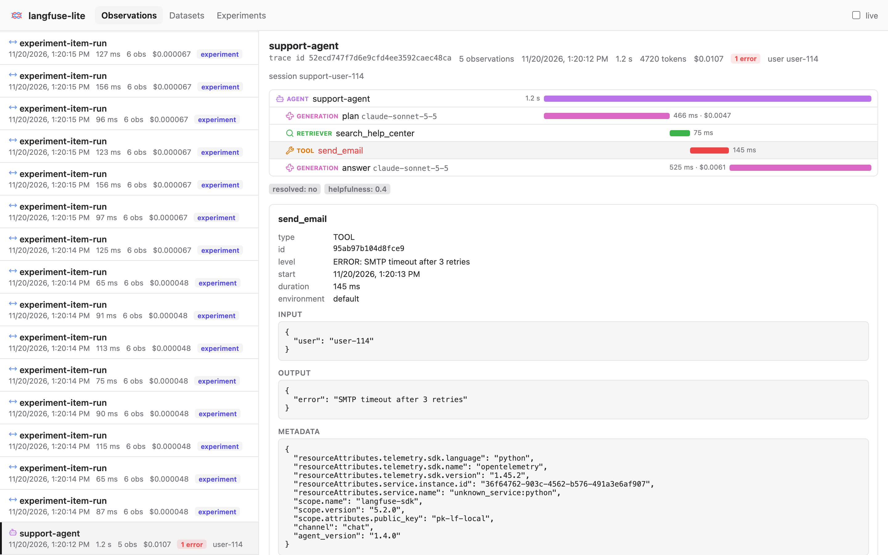

# langfuse-lite

A local Langfuse for code agents: **tracing and experiment runs** in one
process and one SQLite file, with the official Langfuse SDKs unchanged.
No Docker, no account, no databases to run.

> **Status: experiment.** Not published to npm or PyPI yet, and not proven
> that agents will pick it. Build it from this repository for now.

> **Before you use it.** langfuse-lite is a local emulator of Langfuse for
> development, not a way to run Langfuse.
>
> - **No authentication, single tenant.** API keys are not checked: any key, or
>   none, is accepted (the SDKs only need a placeholder to start). There is one
>   project and no users. Anyone who can reach the port can read and write all
>   data, prompts and outputs included.
> - **Not security hardened** like Langfuse Cloud or a self-hosted Langfuse. It
>   listens on `127.0.0.1` only; never expose it to a network you do not trust.
> - **No compatibility guarantee.** It implements part of the Langfuse public
>   API and may differ from Langfuse Cloud or lag behind it.
> - **Not built for load.** For performance, scale and production use, switch
>   to [Langfuse Cloud](https://cloud.langfuse.com) or
>   [self-host Langfuse](https://langfuse.com/self-hosting).

```bash
git clone https://github.com/langfuse/langfuse-lite && cd langfuse-lite
npm install && npm run build      # needs Node 22.13+ and Bun
node dist/cli.js serve            # once published: npx -y langfuse-lite serve
```

```bash
export LANGFUSE_BASE_URL=http://localhost:3000 LANGFUSE_PUBLIC_KEY=pk-lf-local LANGFUSE_SECRET_KEY=sk-lf-local
```

Trace and run experiments with the Langfuse SDKs as usual, or send any
OpenTelemetry spans to `/api/public/otel/v1/traces`. Data goes to
`./.langfuse/lite.db`; the viewer is at http://localhost:3000.



## Why

When code agents add observability or evals to a project, they often name
Langfuse as the default choice and then build something themselves instead.
The reasons they give are the same each time: Langfuse needs an account and
API keys they do not have, they cannot verify from inside their sandbox that
it works, and self-hosting means running several databases.

> "Langfuse is the leading candidate." … "both platforms require external API
> keys and accounts." … "I'm pivoting to a self-contained implementation."
>
> "I will implement the pipeline in-repo rather than using external SaaS, so it actually runs."
>
> <sub>Code agents in our test sessions.</sub>

langfuse-lite removes those reasons: an agent starts it with one command,
needs no keys, and can read the results back itself.

- **Same SDKs, same code.** To continue in Langfuse Cloud or a self-hosted
  Langfuse, change the host and API keys; `push` copies the local data over.
- **Small on purpose.** It covers only tracing, scores, datasets and
  experiments, and reuses Langfuse's own span conversion and cost code. We
  expect it to need an update only for major releases of Langfuse or the SDKs.

## Commands

They read the database directly, so they work while the server runs or after.
Every command takes `--json`; `--db <path>` or `LANGFUSE_LITE_DB` picks another database.

```text
langfuse-lite observations                    # root observations, newest first
langfuse-lite observations --level ERROR --io # filter: --level --name --type --trace --experiment --since
langfuse-lite tree <trace id>                 # every observation of one trace, as a tree
langfuse-lite runs                            # experiment runs with average scores
langfuse-lite compare <run> <run>             # runs side by side, item by item
langfuse-lite sql "SELECT ..."                # read-only SQL on observations, scores, datasets
langfuse-lite export --out run.html           # the viewer and its data in one file
langfuse-lite push --to https://cloud.langfuse.com   # copy everything to a full Langfuse
```

```text
$ langfuse-lite tree 478d02 --io
trace id 478d02b45e251eadf418f4546f2e2827  ·  support-agent  ·  5 observations  ·  1.2s  ·  4720 tokens  ·  $0.0107  ·  1 error
└─ AGENT  support-agent  1.2s
   ├─ GENERATION  plan  claude-sonnet-5-5  2010→64 tok  $0.0047  460ms
   ├─ RETRIEVER  search_help_center  71ms
   ├─ TOOL  send_email  140ms  ERROR: SMTP timeout after 3 retries
   └─ GENERATION  answer  claude-sonnet-5-5  2550→96 tok  $0.0061  520ms
scores: resolved=no, helpfulness=0.4 "tool failed, offered a workaround"
```

In Python, the PyPI package registers pytest fixtures (`langfuse_lite`,
`langfuse_lite_env`) and a `serve()` context manager that start a server on a
free port with a temporary database.

## What it serves

The part of the Langfuse public API that the SDKs (Python 5.x, JS 6.x) use for
tracing and experiments. Everything else answers 501.

| Endpoint | |
|---|---|
| `POST /api/public/otel/v1/traces` | OTLP over HTTP, protobuf or JSON |
| `POST /api/public/scores`, `GET /api/public/v3/scores` | |
| `/api/public/v2/datasets`, `/api/public/dataset-items` | create, list, get, delete |
| `GET /api/public/v2/observations` | |
| `GET /api/public/experiments`, `/api/public/experiment-items` | |

Not included: prompt management, evaluators running in Langfuse, dashboards,
the metrics API, access control, media, annotation queues.

## How it works

- OTel spans become observations through Langfuse's own conversion and cost
  code, vendored unchanged from the official worker image (`vendor/langfuse/`).
- One SQLite file on Langfuse v4's data model: an `observations` table, plus
  `scores`, `datasets` and `dataset_items`. Raw OTLP requests are kept, which
  is what `push` replays.
- TypeScript on Node's and Bun's built-in SQLite, with no runtime dependencies.
  Ships as one JS file, as standalone executables and as PyPI wheels.

## Security and limits

- **No authentication.** API keys are not checked, and `serve` listens on
  `127.0.0.1` only; whoever can reach the port can read and write everything.
  `--host` opens it to the network: do that on a trusted network only.
- Requests from other websites are refused; set `LANGFUSE_LITE_ALLOWED_HOSTS`
  to serve it under another host name.
- For local use: one request at a time, bodies up to 64 MB. For more, use
  Langfuse Cloud or a self-hosted Langfuse.
- Cost uses Langfuse's default model prices only.

## Telemetry

`serve` and `push` send anonymous usage counts to Langfuse (via PostHog EU), so
we can tell whether langfuse-lite is used at all. Like self-hosted Langfuse,
it never sends traces, prompts, outputs, names, ids, paths or host names.

- **Sent:** langfuse-lite, Langfuse and runtime versions, OS, the number of
  observations, traces, scores, datasets and experiment runs, which SDKs sent
  data, and after `push` the counts moved and whether the target was Langfuse
  Cloud. Each database gets a random id.
- **When:** at `serve` start, once after the first trace of a session, hourly
  while data keeps arriving, and after `push`. The read commands send nothing.
- **Off:** `TELEMETRY_ENABLED=false` or `DO_NOT_TRACK=1`. It is always off in
  CI (`CI` is set) and for the temporary databases of the Python fixtures.

The code is in [`src/telemetry.ts`](src/telemetry.ts).

Development setup, the conformance tests against a full Langfuse and
measurements are in [docs/development.md](docs/development.md); the original
design plan is in [docs/slim-server.md](docs/slim-server.md).

## License

MIT. The vendored Langfuse code is MIT as well (`vendor/LICENSE-langfuse`).
